# CyberSecGuard — Integrated Cybersecurity Assessment Suite

**Python · MySQL · Nmap · Wireshark · JavaScript · Docker**

An integrated cybersecurity assessment suite combining an Nmap-powered
vulnerability scanner, a Wireshark (tshark)-based traffic analyzer, and a
bcrypt-backed password checker and secure vault, all in one JavaScript
dashboard with centralized, real-time visibility into scans, traffic, and
password security. Every result is persisted to MySQL.

> **Live showcase site:** `https://avinash09-cmd.github.io/cybersec-guard-fullstack/`
> (static project page with a working in-browser password checker).
> The full dashboard needs the Flask + MySQL backend, so it runs locally; see [Setup](#setup) (one command with Docker).

---

## Screenshots

> The dashboard screenshots use sample data so the UI is easy to see. With the backend running, the same screens show your real scans, captures and vault entries.

### Dashboard

**Scanner:** run an Nmap scan against a target, see open ports with service banners and risk notes, and browse scan history stored in MySQL.

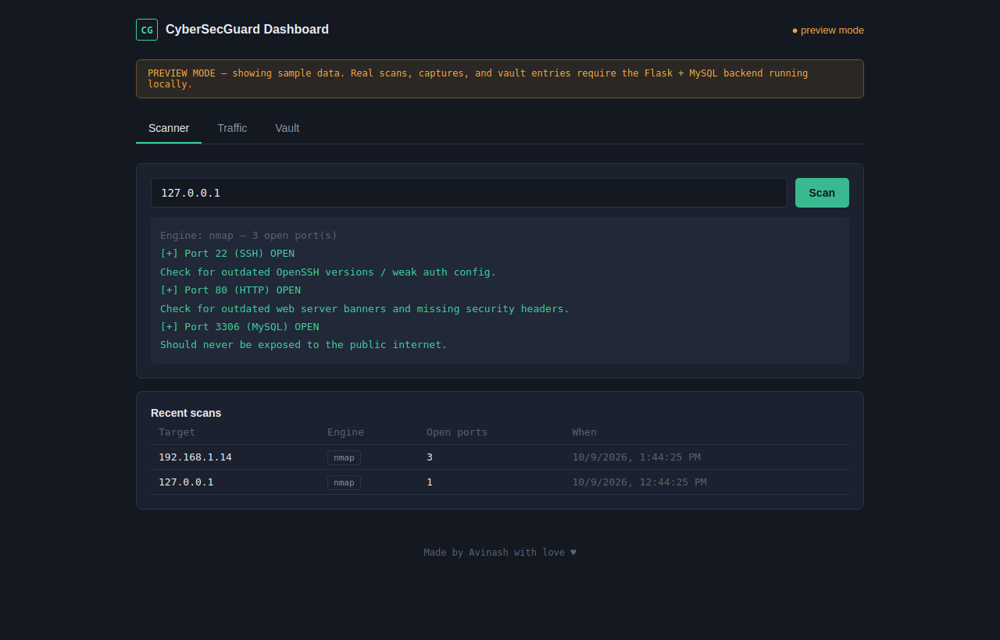

**Traffic analyzer:** timed packet capture through tshark (Wireshark's engine) with a protocol breakdown and anomaly alerts for ARP spoofing, SYN floods and port scans.

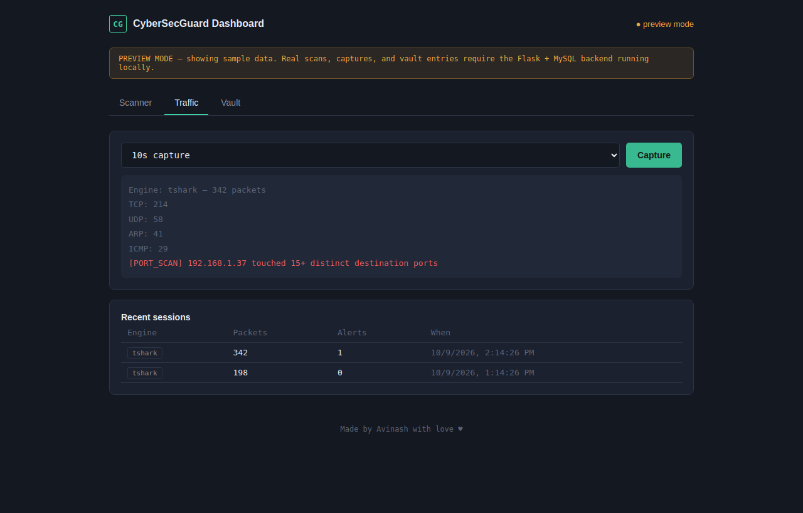

**Password strength checker:** entropy-based score, estimated offline crack time and pattern checks as you type.

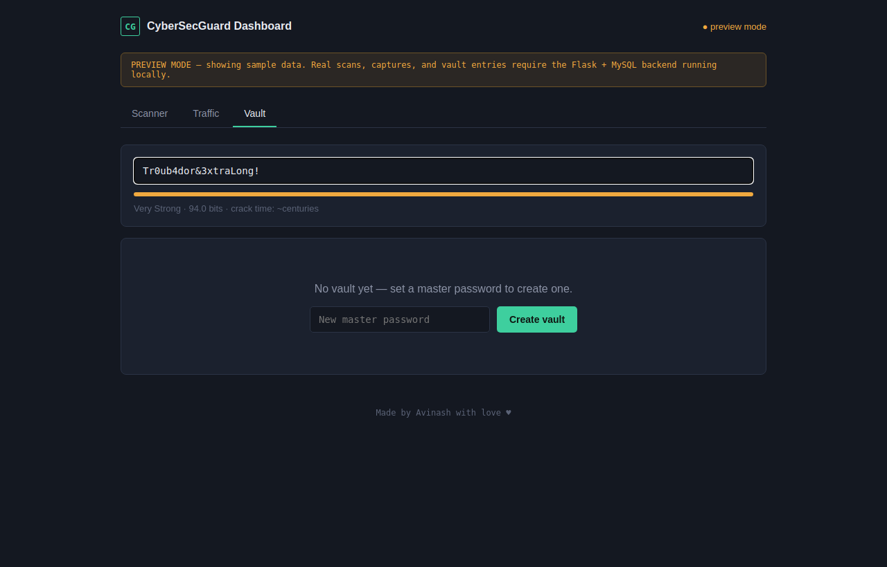

**Encrypted vault:** the first visit asks you to create a master password (stored as a bcrypt hash); afterwards the vault stays locked until you unlock it.

<table>
  <tr>
    <td width="50%">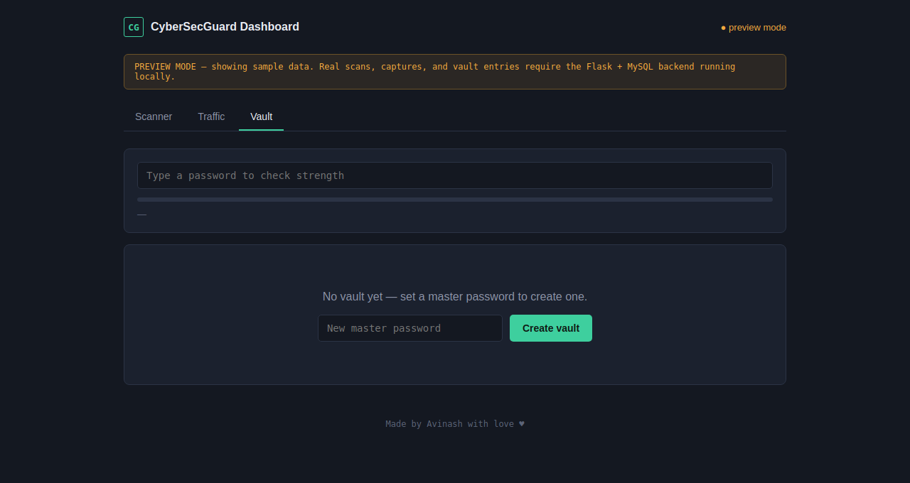<br><sub>1. Create the vault</sub></td>
    <td width="50%">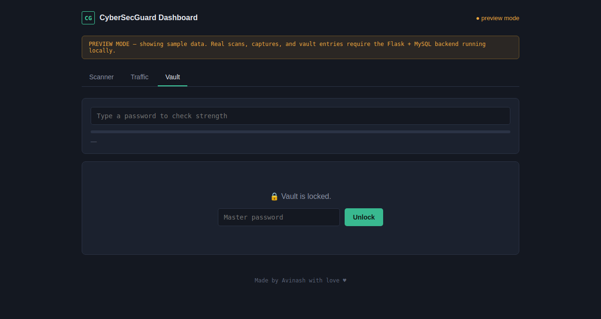<br><sub>2. Vault locked</sub></td>
  </tr>
</table>

Once unlocked, entries are listed by site and username. Passwords stay Fernet/AES-encrypted in MySQL and are only decrypted when you click **Reveal**.

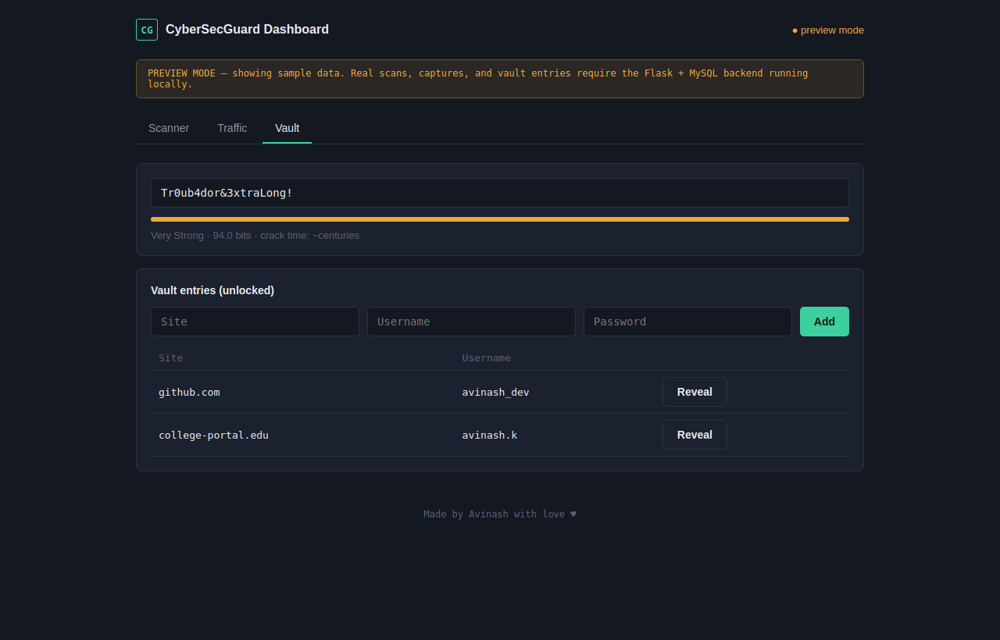

### Features in detail

**Password feedback:** weak passwords get a clear explanation of what's wrong (length, variety, sequences, common passwords).

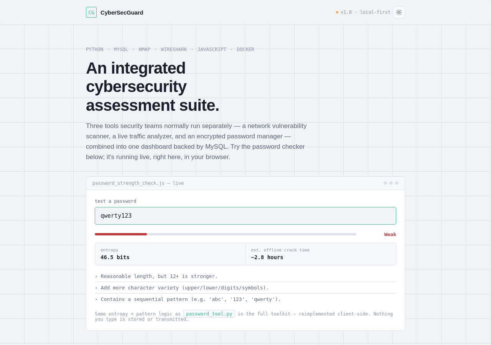

**Scan report:** open ports, banners, and what each exposed service is known for.

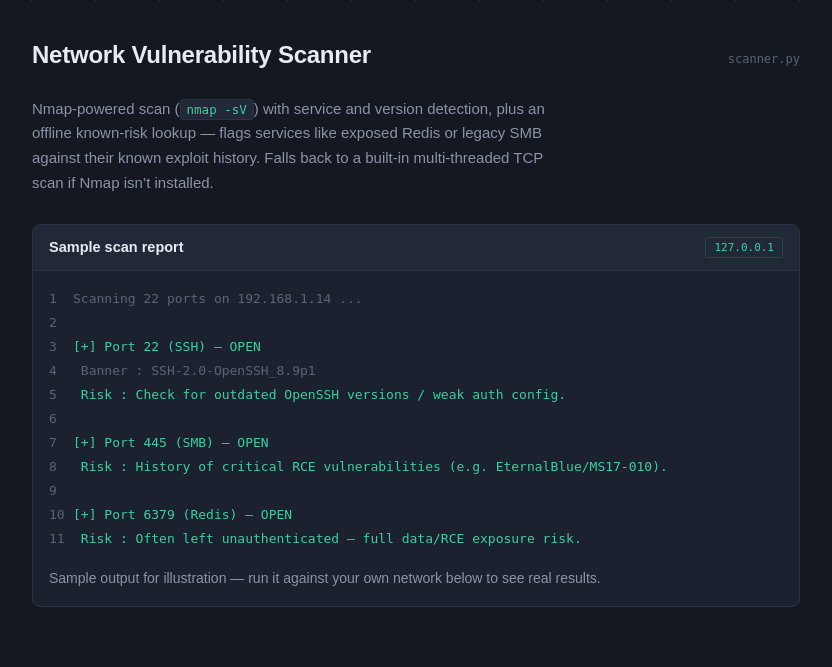

**Traffic report:** protocol counts and the alerts raised during a capture.

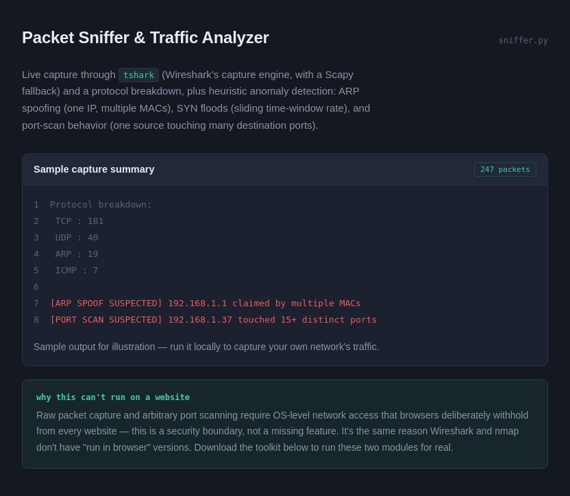

### Showcase website

A static project page (hosted on GitHub Pages) with a working in-browser password checker and a light/dark theme toggle.

<table>
  <tr>
    <td width="50%">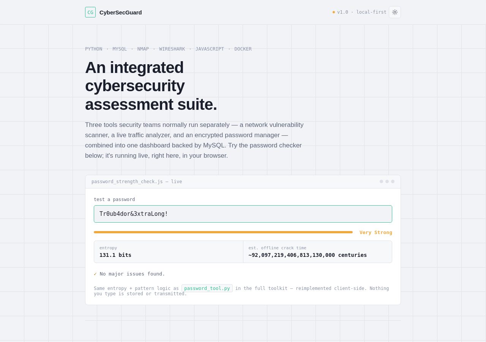<br><sub>Light mode</sub></td>
    <td width="50%">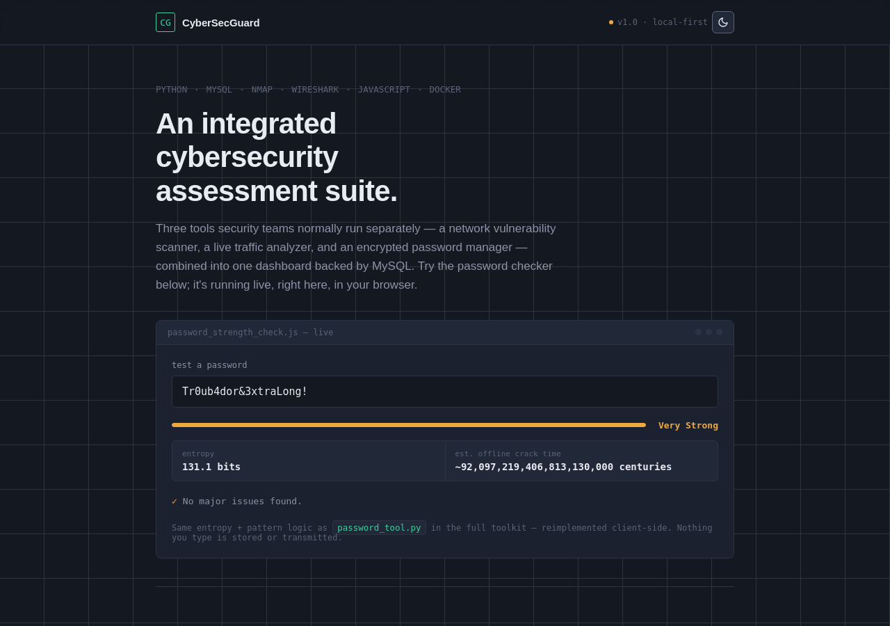<br><sub>Dark mode</sub></td>
  </tr>
</table>

### Docker setup

Three steps from clone to running dashboard.

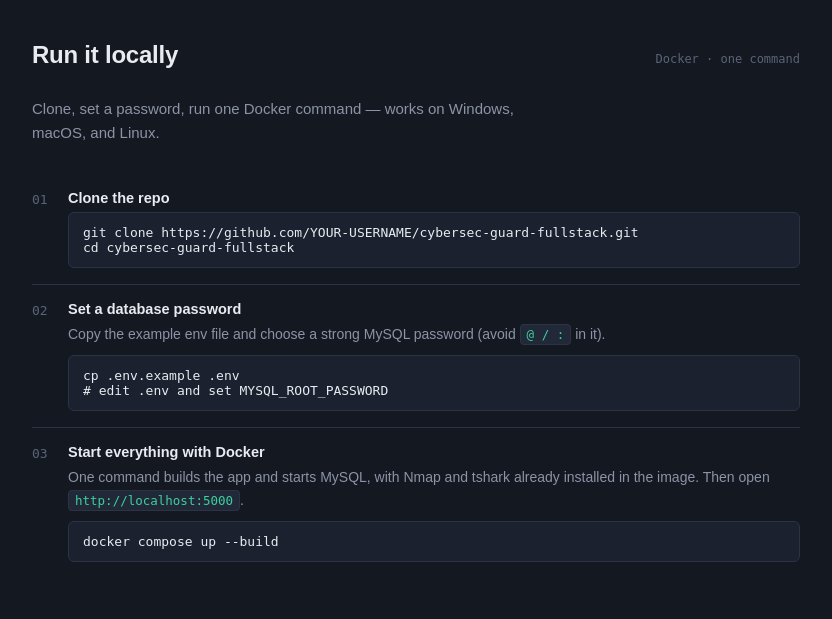

---

## Features

- **Nmap vulnerability scanner**: `nmap -sV` with XML parsing, a known-risk lookup (e.g. SMB → EternalBlue history, exposed Redis), and a built-in fallback scan when Nmap isn't installed
- **Wireshark (tshark) traffic analyzer**: live capture, protocol breakdown, and heuristics for ARP spoofing, SYN floods, and port scanning, with a Scapy fallback
- **bcrypt-backed password vault**: bcrypt authenticates the master password; a PBKDF2-derived AES key (Fernet) encrypts the stored entries
- **MySQL persistence**: scan history, traffic sessions, alerts, and vault entries
- **JavaScript dashboard**: one page, three tabs, served by a Flask REST API

## Architecture

```
cybersec-guard-fullstack/
├── backend/
│   ├── app.py              Flask REST API connecting the dashboard to all 3 modules
│   ├── database.py         SQLAlchemy models (MySQL)
│   ├── scanner.py          Nmap-powered vulnerability scanner
│   ├── sniffer.py          tshark (Wireshark)-powered traffic analyzer
│   ├── password_tool.py    bcrypt auth + PBKDF2/Fernet encrypted vault
│   ├── schema.sql          Reference SQL schema
│   └── requirements.txt
├── dashboard/
│   └── index.html          JavaScript dashboard (Scanner / Traffic / Vault)
├── Dockerfile              App image (Python + Nmap + tshark)
├── docker-compose.yml      App + MySQL services
├── .env.example            Template for the MySQL password
└── docs/
    ├── index.html          Static showcase site (served by GitHub Pages)
    └── screenshots/        README images
```

## How each engine is used

| Module | Primary engine | Fallback | Why |
|---|---|---|---|
| Vulnerability Scanner | **Nmap** (`nmap -sV -oX -`, XML parsed) | Built-in threaded TCP scan | Nmap gives real service/version detection; the fallback keeps the tool usable without Nmap installed |
| Traffic Analyzer | **tshark** (Wireshark's CLI capture engine) | Scapy | tshark shares Wireshark's dissection engine; Scapy covers systems without Wireshark |
| Password Vault | **bcrypt** (master password auth) + **PBKDF2/Fernet** (entry encryption) | None | bcrypt is a one-way hash, right for "does this password match?" but it can't decrypt data. A PBKDF2-derived AES key handles encrypting and decrypting vault entries. |

## Setup

### Option 1: Docker (recommended)

Docker runs the app, MySQL, Nmap and tshark together, so nothing needs installing by hand except Docker itself.

```bash
git clone https://github.com/avinash09-cmd/cybersec-guard-fullstack.git
cd cybersec-guard-fullstack
cp .env.example .env          # Windows PowerShell: copy .env.example .env
# edit .env and set MYSQL_ROOT_PASSWORD (avoid the characters @ / : in it)
docker compose up --build
```

Open **http://localhost:5000**. The first start takes a few minutes while images download and build.

| Command | What it does |
|---|---|
| `docker compose up --build` | Build and start the app and MySQL |
| `docker compose up -d` | Start in the background |
| `docker compose logs -f app` | Follow the app's logs |
| `docker compose down` | Stop everything (data is kept) |
| `docker compose down -v` | Stop and delete the MySQL data volume |

**What to expect inside a container**
- **Scanner:** works normally. `127.0.0.1` means the container itself; to scan your own computer use `host.docker.internal`, or scan other devices by their IP address.
- **Traffic analyzer:** the container is granted the `NET_RAW` and `NET_ADMIN` capabilities it needs, but on Docker Desktop (Windows/macOS) it only sees the container's own virtual network. For capture of your real network, run the app directly on the host (Option 2) or use `network_mode: host` on Linux.
- **Vault data:** stored in the `mysql_data` Docker volume, so it survives restarts.

### Option 2: Run directly on your machine

1. **Install MySQL** (XAMPP is easiest on Windows) and create the database:
   ```sql
   CREATE DATABASE cybersecguard;
   ```
2. **Install dependencies**
   ```bash
   cd backend
   python -m venv venv
   venv\Scripts\Activate.ps1      # Windows  (macOS/Linux: source venv/bin/activate)
   pip install -r requirements.txt
   ```
3. **Point the app at MySQL**
   ```powershell
   $env:DATABASE_URL = "mysql+pymysql://root:@localhost/cybersecguard"   # Windows PowerShell
   ```
   ```bash
   export DATABASE_URL="mysql+pymysql://root:@localhost/cybersecguard"   # macOS/Linux
   ```
4. **Run**
   ```bash
   python app.py
   ```
   Open **http://localhost:5000**.

> **Nmap:** install from [nmap.org](https://nmap.org/download.html) and make sure it's on your PATH.
> **Wireshark/tshark:** install [Wireshark](https://www.wireshark.org/download.html), which includes tshark. Packet capture needs Administrator/root.

## API Reference

| Endpoint | Method | Purpose |
|---|---|---|
| `/api/scan` | POST | Run a scan against a target |
| `/api/scans` | GET | Recent scan history |
| `/api/sniff` | POST | Run a timed packet capture |
| `/api/alerts` | GET | Recent traffic sessions and alerts |
| `/api/password/check` | POST | Score password strength |
| `/api/vault/status` | GET | Whether a vault exists |
| `/api/vault/setup` | POST | Create the vault (stores bcrypt hash) |
| `/api/vault/unlock` | POST | Authenticate and get a session token |
| `/api/vault/entries` | GET / POST | List / add vault entries |
| `/api/vault/entries/<id>/reveal` | POST | Decrypt one entry (needs unlock token) |

## Hosting the showcase site on GitHub Pages

GitHub Pages serves static files only, so it hosts the showcase site in `docs/`, not the Flask backend.

1. Push this repo to GitHub.
2. Repo **Settings → Pages**.
3. Source: **Deploy from a branch** → branch `main` → folder `/docs` → **Save**.
4. After a minute, the site is live at `https://avinash09-cmd.github.io/cybersec-guard-fullstack/`.

## Disclaimer

For educational use only. Scan and capture only systems and networks you own or have explicit permission to test.

---

<p align="center">Made by Avinash with love ♥</p>
